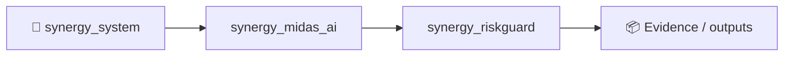
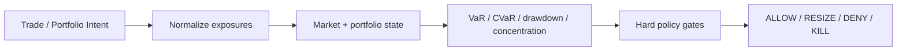

# SYNERGY RiskGuard

> **Independent pre-trade and portfolio risk control with VaR/CVaR, drawdown veto and kill-switch**

Version: `2.0.0`

**Enterprise v2.0.0** · Python 3.11+ · FastAPI/OpenAPI · Docker/Compose · PostgreSQL/ClickHouse audit · RBAC/JWT · CI/tests

**Designed for:** Prop firms, brokers, quant funds, family offices and trading desks  
**Primary endpoint:** `POST /enterprise/v1/risk/check`  
**Commercial mode:** paid technical pilot · source-code licensing · OEM/white-label integration

> [!IMPORTANT]
> Trading/research infrastructure only. No promise of investment return, profitable execution or regulatory approval. Production requires customer OOS/paper/canary evidence and Security/Risk/Ops/Compliance sign-off.

## Fund-facing capabilities
- deterministic product core separated from enterprise controls;
- tenant RBAC, request-ID audit, PostgreSQL + ClickHouse;
- health/Prometheus metrics and bounded retry/circuit-breaker;
- Bybit V5, CCXT and MT5 integration contracts; live execution off by default;
- Docker/Compose, synthetic demo data, load harnesses and due-diligence documentation.

## Verification snapshot
| Evidence | Snapshot |
|---|---:|
| tests | **21 passed** |
| health smoke | **80/80 HTTP 200** |
| p50 / p95 / p99 | **15.4 / 69 / 82.8 ms** |
| local throughput | **539 req/s** |

Local health smoke only; not a production SLA or market/execution benchmark.

## Quick evaluation
```bash
python -m venv .venv && source .venv/bin/activate
pip install -e '.[dev,enterprise]'
pytest -q
python -m synergy_riskguard.api
```
Open `http://127.0.0.1:8000/docs`.

## CTO package
[Due diligence](docs/CTO_DUE_DILIGENCE.md) · [Architecture](docs/ARCHITECTURE_DIAGRAMS.md) · [API](docs/API_EXAMPLES.md) · [Security](SECURITY.md) · [Benchmarks](docs/BENCHMARKS_AND_ACCEPTANCE.md) · [SLA/SLO](docs/SLA_SLO.md) · [Deployment](docs/DEPLOYMENT_CHECKLIST.md) · [Pilot](docs/CUSTOMER_PILOT.md)


<!-- SYNERGY-FEDERATION-PASSPORT:START -->
---

## 🧭 SYNERGY federation passport

**Домен:** 🛡️ Independent risk layer  
**Архитектурный родитель:** [`synergy_midas_ai`](https://github.com/Shtenco/synergy_midas_ai)  
**Архитектурный корень:** [`synergy_system`](https://github.com/Shtenco/synergy_system)



### Документационный контракт

README должен показывать: проблему → архитектуру → реальные артефакты → проверку → ограничения → связи с федерацией. Сильные claims без evidence остаются R&D/CANDIDATE.

### Навигация

- [📚 Атлас всех 75 репозиториев](https://github.com/Shtenco/synergy_system/blob/main/docs/SYNERGY_REPOSITORY_ATLAS.md)
- [🧾 Машиночитаемый registry](https://github.com/Shtenco/synergy_system/blob/main/registry/SYNERGY_REPOSITORIES.json)
- [🧭 SYNERGY SYSTEM](https://github.com/Shtenco/synergy_system)

### Authority rule

Репозиторий не присваивает полномочия соседнего домена: AI ≠ authorization, UI ≠ ledger, blockchain commitment ≠ accounting truth, backtest ≠ realized external P&L.

<!-- SYNERGY-FEDERATION-PASSPORT:END -->
---

# 🛡️ Глубокая техническая спецификация RiskGuard

## 🎯 Проблема

Стратегия может быть статистически интересной и одновременно недопустимой по портфельному риску. RiskGuard существует как независимый veto-слой, который не должен зависеть от «уверенности» стратегии.

## 🏗️ Pipeline



## 📥 Входы

- позиции и pending intents;
- NAV/equity snapshot;
- volatility/covariance inputs;
- venue/asset exposure;
- liquidity/spread state;
- policy limits;

## 📤 Выходы

- risk decision;
- approved size or zero;
- limit breaches;
- kill-switch reason;
- auditable request/decision id;

## 🛡️ Непереговорные инварианты

```text
strategy cannot override DENY
stale portfolio state must fail closed
risk calculations must bind timestamp/state version
limit changes require explicit policy provenance
NO_TRADE is valid
```

## 🧪 Как ловить ложный GREEN

- отделять API/health benchmark от качества торгового решения;
- проверять stale-state и timestamp binding;
- иметь negative/adversarial tests;
- не считать unit-test coverage доказательством инвестиционной ценности;
- сохранять request → decision → downstream evidence chain;
- явно указывать, что измерено локально, а что требует customer/live validation.

## 🔗 Контракт с соседями

- [`synergy_midas_ai`](https://github.com/Shtenco/synergy_midas_ai)
- [`synergy_quantlab`](https://github.com/Shtenco/synergy_quantlab)
- [`synergy_trademux`](https://github.com/Shtenco/synergy_trademux)
- [`synergy_financial_os`](https://github.com/Shtenco/synergy_financial_os)

## 🚀 Следующий доказательный рубеж

1. frozen acceptance dataset;
2. adversarial fixtures;
3. cross-module typed contract;
4. end-to-end trace id;
5. OOS/shadow evidence where market quality is claimed;
6. explicit failure-mode table;
7. reproducible evidence bundle referenced from README.
