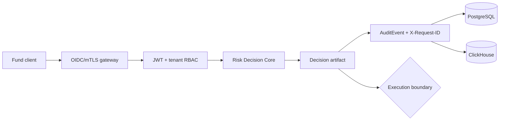

# Architecture diagrams — SYNERGY RiskGuard

Primary action: `POST /enterprise/v1/risk/check`. Authentication failures deny. Live execution remains separately gated. Retry/circuit-breaker logic is bounded and never blindly replays unknown financial side effects.